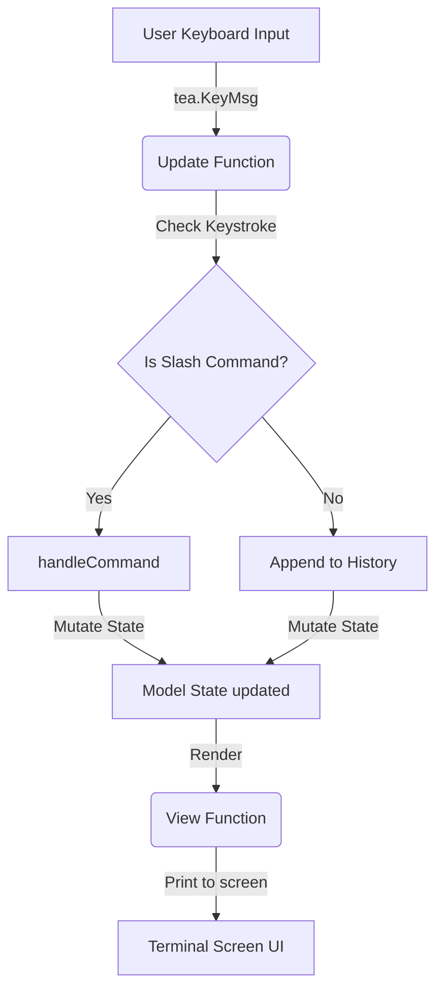

# Exercise 001: Echo REPL & Command History

This is the first exercise in the Go TUI Harness curriculum. In this project, you build an interactive Command-Line Interface (CLI) **REPL (Read-Eval-Print Loop)** with a scrollable **History Log** panel. 

The application is built in Go using **Bubble Tea** (the Elm Architecture framework for terminal apps) and styled beautifully with **Lip Gloss**.

---

## The Visual Layout

The application renders a custom terminal viewport split into three clean logical sections:

```text
 ┌────────────────────────────────────────────────────────┐
 │  HISTORY LOG                                        │
 ├────────────────────────────────────────────────────────┤
 │  01. hello world                                       │
 │  02. building custom inputs                            │
 └────────────────────────────────────────────────────────┘
 
  > /delete 2█
  💡 Commands: /pop (delete last) • /shift (delete first) • /delete <num> • /clean (delete all) • /quit /exit (exit)
```

1.  **History Panel (Top):** A stylized rounded box rendering all successfully submitted text history. Each entry is neatly numbered with index coloring.
2.  **Interactive Prompt (Middle):** A sticky command-line input with a custom cyan prompt (` > `) and an active, styled visual cursor (`█`) that updates as you type.
3.  **Help Legend (Bottom):** An italicized, low-contrast guide displaying the available slash-commands and exit shortcuts.

---

## How It Works (Under the Hood)

The TUI utilizes **The Elm Architecture (Model-Update-View)**. Here is how state transitions through the code inside [`main.go`](file:///Users/josegaldamez/Documents/golang/go_tui_exercises/001_echo_repl_history/main.go):



### 1. State Model
The single source of truth is the `model` struct:
```go
type model struct {
	history      []string // Stores all successfully executed entries
	currentInput string   // Buffer accumulating current keystrokes
}
```

### 2. Event Handling (`Update`)
The `Update` function acts as the state transition router:
*   **Text Accumulation (`tea.KeyRunes`, `tea.KeySpace`):** Every character pressed is appended to `model.currentInput`.
*   **Defensive Backspacing (`tea.KeyBackspace`):** To avoid index out-of-bounds panics, backspacing converts the input into a `[]rune` slice first, checks if it has elements, and slices off the last rune:
    ```go
    runes := []rune(model.currentInput)
    if len(runes) > 0 {
        model.currentInput = string(runes[:len(runes)-1])
    }
    ```
*   **Submission (`tea.KeyEnter`):** When Enter is hit, the input is trimmed. If it's prefixed with `/`, it is treated as a command; otherwise, it is appended to the history list. The input buffer is then reset.

### 3. Command Router (`handleCommand`)
Slash commands intercept standard text submission to perform operations on the history slice:
*   `/pop` - Deletes the last item in the history slice using standard Go reslicing: `model.history[:len(model.history)-1]`
*   `/shift` - Deletes the first item in the history slice: `model.history[1:]`
*   `/clean` - Wipes all history: `[]string{}`
*   `/delete <index>` - Safely parses the 1-based index, converts it to 0-based slice coordinates, and performs a safe extraction:
    ```go
    model.history = append(model.history[:sliceIndex], model.history[sliceIndex+1:]...)
    ```
*   `/quit` or `/exit` - Dispatches the Bubble Tea `tea.Quit` command to cleanly shut down the program.

### 4. Layout Rendering (`View`)
The `View` function joins the history box, the active prompt, and the help footer vertically using Lip Gloss layout functions:
```go
return lipgloss.JoinVertical(
    lipgloss.Left,
    historyBoxStyle.Render(s.String()),
    "",
    interactivePrompt,
    helpText,
    "",
)
```

---

## Running the Project

To execute this project, open your terminal inside the exercise directory and run:

```bash
# Run the application directly
go run main.go
```

### Try These Steps to Test:
1. Type a few standard phrases (e.g., `Hello TUI`, `Bubble Tea is awesome`) and press **Enter** to see them populate the History Log.
2. Type `/pop` and press **Enter** to delete the last item.
3. Type `/delete 1` and press **Enter** to remove the first item.
4. Type `/clean` to clear all logs.
5. Press `Esc` or type `/quit` to gracefully exit the application.

---

## Architectural Safety & Best Practices

Building an interactive CLI harness in a raw terminal environment requires deep appreciation for state boundaries and byte manipulation. Here is the core architecture safety checklist covered in this exercise:

| Risk Category | Consequence | How It is Prevented in This Project |
| :--- | :--- | :--- |
| **Screen Flickering** | Stuttering or high-frequency flash when drawing frames. | **Differential Rendering:** Rely entirely on Bubble Tea's internal buffer. Never invoke manual ANSI escape clearing or `clear` commands. |
| **Slice Index Panic** | Crash with `panic: slice bounds out of range` on double backspace. | **Defensive Slicing:** Perform bounds checking (`if len(runes) > 0`) before attempting to slice the active buffer. |
| **UTF-8 Corruption** | Slicing raw bytes cuts multi-byte runes (like emojis `🚀` or accented characters `ñ`) in half, causing visual garbage. | **Rune Translation:** Convert inputs into a `[]rune` slice before performing character-level deletion or truncation. |
| **Invalid Command Index** | Slicing `history` when running `/delete 99` in a 3-item list crashes the process. | **Bounds Validation:** Carefully validate integer parses and verify `index >= 0 && index < len(history)` before mutation. |

---

## Stretch Challenges (Extra Credit)

Ready to take your CLI Harness to the next level? Extend the exercise by building these advanced features:

1. **Command Error Highlight:** Detect invalid commands (e.g. `/delete abc` or `/unknown`) and show a red error notification bar at the bottom.
2. **Smart Tab-Completion:** Pressing `Tab` cycles through matching slash commands (`/pop`, `/shift`, `/clean`, `/delete`).
3. **Persisted History Logs:** Read and write history inputs into a local file or SQLite database, so your CLI history is preserved across sessions!

