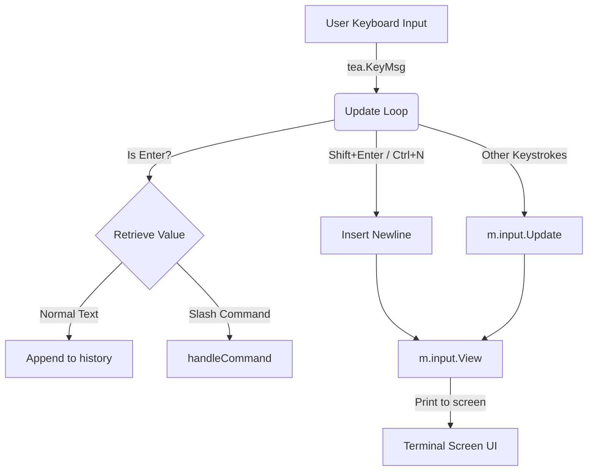

# Exercise 002: Textarea REPL & Command History

This is the second exercise in the Go TUI Harness curriculum. In this project, we refactor the interactive Command-Line Interface (CLI) **REPL** and **History Log** from Exercise 001. We replace the custom manual character-by-character rune buffer and simulated cursor logic with the standard **`github.com/charmbracelet/bubbles/textarea`** component, enabling multiline inputs.

---

## Visual Layout & Controls

The visual presentation remains identical to Exercise 001, but the underlying text control is significantly more powerful, robust, and responsive:

```text
 ┌────────────────────────────────────────────────────────┐
 │  HISTORY LOG                                           │
 ├────────────────────────────────────────────────────────┤
 │  01. hello world                                       │
 │  02. building custom inputs                            │
 └────────────────────────────────────────────────────────┘
 
  > /delete 2█
  💡 Commands: Enter (Submit) • Shift+Enter / Ctrl+N (Newline) • /pop (delete last) • /shift (delete first) • /delete <num> • /clean (delete all) • /quit /exit (exit)
```

1.  **History Panel (Top):** A Lip Gloss styled container showing your previous submissions.
2.  **Interactive Prompt (Middle):** Powered by `bubbles/textarea`, utilizing built-in cursor blinking, multiline input support, input focus, dynamic width resizing, and custom dark background styling. Hitting **Enter** submits, and **Shift+Enter** or **Ctrl+N** inserts newlines.
3.  **Help Legend (Bottom):** Italicized controls.

---

## Refactored Architecture

Under the hood, we transition from tracking a raw string buffer to coordinating an interactive Bubble Tea sub-component.

### 1. State Model Refactor

In **Exercise 001**, the model accumulated raw characters:
```go
type model struct {
    history      []string
    currentInput string // Manual raw buffer
}
```

In **Exercise 002**, we delegate state, cursors, and bindings to `textarea.Model`:
```go
type model struct {
    history []string
    input   textarea.Model // Managed component
}
```

### 2. State & Style Initialization

```go
ta := textarea.New()
ta.Placeholder = "Type command or message here..."
ta.Focus()
ta.Prompt = " > "
ta.ShowLineNumbers = false

// Apply identical elegant styling via textarea API
ta.FocusedStyle, ta.BlurredStyle = textarea.DefaultStyles()
ta.FocusedStyle.Text = lipgloss.NewStyle().Foreground(lightGrayColor)
ta.FocusedStyle.Prompt = promptSymbolStyle
ta.Cursor.Style = cursorStyle

ta.SetHeight(3)
ta.SetWidth(60)
```

### 3. Elm Architecture Flow with sub-components

The sub-component handles keyboard logic internally. We only need to intercept specific layout actions (like `Enter` for submission, `Shift+Enter` / `Ctrl+N` for inserting newlines, and exit keystrokes) and forward everything else to `m.input.Update`:



---

## Architecture Safety Checklist Comparison

By replacing the manual implementation with `bubbles/textarea`, we solve several edge-case bugs and enhance the terminal experience:

| Feature / Risk | Manual Implementation (001) | standard `textarea` Component (002) |
| :--- | :--- | :--- |
| **Cursor Blinking** | Static block character (`█`) appended to string in `View`. | Automatic blinking cursor handled asynchronously via the `textarea.Blink` tick command. |
| **Unicode Safety** | Manually slice with `[]rune(input)` to avoid cutting multi-byte UTF-8 emojis/characters. | Built-in character bounds validation and full UTF-8/Unicode support out-of-the-box. |
| **Line Navigation** | Writing is strictly append-only. Cursor is locked at the end. | Built-in support for **Home**, **End**, and **Arrow** key navigation (up/down/left/right), allowing users to edit mid-string across lines. |
| **Multiline Support** | Single-line only. | Supports multiple lines of text. `Shift+Enter` or `Ctrl+N` inserts a new line. |
| **Text Actions** | Requires writing custom character addition/deletion routines. | Built-in support for standard text manipulation keys (e.g., Backspace, Delete). |

---

## Running the Project

To execute the application:

```bash
# Run the application directly
go run main.go
```

### Try These Steps to Test:
1. Type text and press **Enter** to submit it to the history panel.
2. Press **Shift+Enter** or **Ctrl+N** to insert newlines and write multiple lines.
3. Use the arrow keys to navigate through the lines.
4. Submit the multiline text by pressing **Enter**.
5. Submit slash commands like `/pop`, `/shift`, `/delete <num>`, `/clean`, or `/quit` by typing them and pressing **Enter**.

